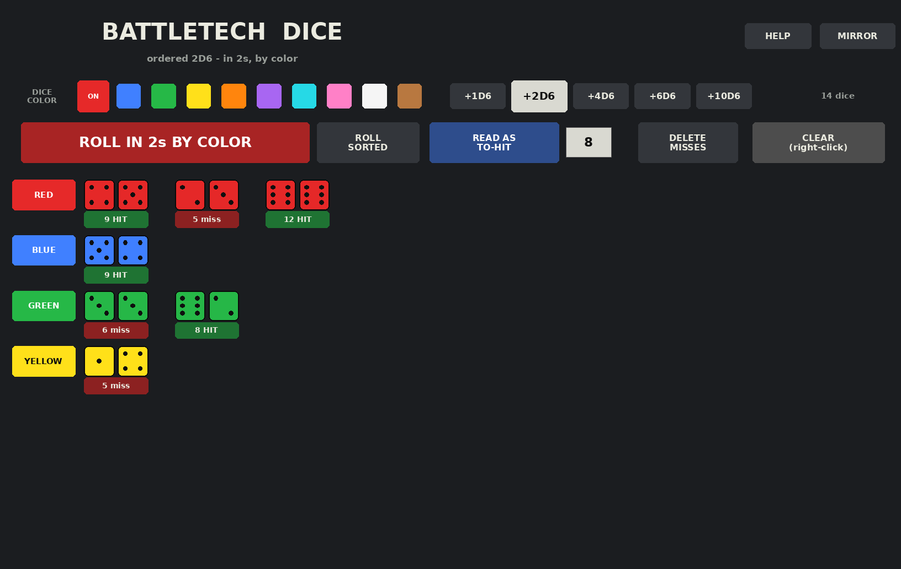

# TTS-Dice-Roller — BattleTech Dice Mat

A portable dice roller for **BattleTech games on Tabletop Simulator**, built to
feel like the Hutber 40K dice table: pick a color, add dice, press roll. The difference is the
roll that BattleTech needs: **in 2s, by color**. Every color gets its own row,
its dice are paired in 2s *inside that color*, and each pair shows its total.
Two different colors never end up paired together.



*A to-hit volley at TN 8: three lasers (red), an LRM (blue), two SRMs (green)
and a PPC (yellow). Rendered by running the real script against a mock of the
TTS API.*

## Install (Saved Object)

1. Download [`dist/BattleTech Dice Mat.json`](dist/BattleTech%20Dice%20Mat.json)
   and the `.png` thumbnail next to it.
2. Copy both into the `Saves/Saved Objects` folder of your TTS data folder:

   | OS | Folder |
   |---|---|
   | Windows | `%USERPROFILE%\Documents\My Games\Tabletop Simulator\Saves\Saved Objects` |
   | macOS | `~/Library/Tabletop Simulator/Saves/Saved Objects` |
   | Linux | `~/.local/share/Tabletop Simulator/Saves/Saved Objects` |

   (If you moved your TTS data folder in the game's settings, use that location instead.)
3. In TTS: **Objects → Saved Objects → BattleTech Dice Mat**. Drag it to a free
   spot beside the map. It drops onto whatever table or map is there and **locks itself**
   once it has settled, so dice can't push it around. To move it later, unlock it with **L**
   (or right-click → Toggles → Lock).

The mat is a scaled block, and its script draws everything on it, so it
doesn't need any external images. It works in any table, including the BattleTech
mods with all the maps.

**Without the saved object:** scale any flat object (a block works) to roughly
25 × 0.25 × 16 first. The layout sizes itself to the object, so an unscaled
object gives tiny buttons. Then paste [`src/battletech_dice_mat.lua`](src/battletech_dice_mat.lua)
into its script (right-click → Scripting → Scripting Editor, called "Lua Editor"
in older builds) and click *Save & Play*. Save & Play reloads the table, so save
the game first.

## How to use it

1. **Click a DICE COLOR**, then **+2D6** once per weapon. Use a different color for
   each weapon, or each weapon type.
2. **ROLL IN 2s BY COLOR** rolls every die on the mat instantly. The colors go in rows
   (Red, Blue, Green, …), the dice are paired in 2s within each color, and the box
   under each pair shows its result.
3. **Click a pair's result box** to re-roll just that pair.
4. **Right-click CLEAR** to remove all the dice on the mat.

**READ AS** changes what the box under each pair means. Right-click it to go back a step.

| READ AS | Box under each pair | Number box |
|---|---|---|
| SUM | the 2D6 total | – |
| TO-HIT | `9 HIT` / `5 miss` (`NO` if TN is 13+) | **TN** |
| LOC FRONT / LEFT / RIGHT / REAR | 'Mech hit location, e.g. `7 CT`, `6 RT(R)`, `2 CT TAC`, `12 HEAD` | – |
| CLUSTER | missiles that hit, e.g. `9: 12/15` | **SIZE** (15 for an LRM-15) |
| CRIT CHECK | `none` / `CRIT x1` / `CRIT x2` / `CRIT x3` (12 = head or limb blown off) | – |

You can change READ AS after a roll without re-rolling. The labels just update.

### A typical attack

1. +2D6 for each weapon, in its own color. Set READ AS to **TO-HIT** and type the TN.
2. **ROLL IN 2s BY COLOR.** Each pair shows HIT or miss, and the chat posts the hit count.
3. **DELETE MISSES** removes the pairs that missed. The hits stay in their colors.
4. Set READ AS to **LOC FRONT** (or whichever side was hit), then **ROLL** again. Every hit now shows where
   it landed, still in its weapon's color.

Other buttons: **+1D6 … +10D6** add more dice. **ROLL SORTED** rolls and sorts by face
value (rows of 6s, 5s, …, like the 40K table). **HELP** prints these instructions in
chat. **MIRROR** flips the layout if it reads backwards.

The chat gets a color-coded summary, in color order:

```
== Player: IN 2s BY COLOR - TO-HIT (TN 8) ==
RED: 9 HIT  |  5 miss  |  12 HIT
BLUE: 9 HIT
GREEN: 6 miss  |  8 HIT
YELLOW: 5 miss
Hits: 4 / 7
```

### Your own dice work too

Any d6 lying on the mat is included in the roll, including dice from the
BT mod, and it's grouped by its tint. Colors outside the mat's palette get their own row
after the palette colors. Dice in a player's hand and dice off the mat are ignored.

## Multiplayer and saving

* The script runs on the host, so clicks from every seat go through one
  authority and nobody desyncs. The chat header shows who rolled.
* Rolls are instant: the values are chosen by the script (like the Hutber table)
  and the dice are turned to show them. There's no waiting for physics.
* **Are the dice fair?** Yes. TTS's Lua engine (MoonSharp) gives every object its own
  `System.Random`. `math.random(6)` maps it onto 1–6 with a bias of about 2×10⁻⁹. An audit
  ran 3.6 million test rolls on a faithful port of that generator. The faces, the pairs
  (all 36 combinations), the 2D6 totals, triples and runs all came out uniform
  (χ² p-values from 0.27 to 0.95). Each mat seeds from its own GUID plus the clock,
  so two mats never roll the same sequence. It also shuffles the stream by click timing
  before each roll, so rolls can't be predicted from the time the table was loaded.
* The dice color, READ AS, TN and cluster size are saved with the game. After a reload, the labels
  re-attach to the dice still on the mat.
* Other scripts can call `mat.call("api_roll", {color="Red"})` and
  `mat.call("api_get_results")`.

## Troubleshooting

* **The layout reads backwards (rows start on the right):** press **MIRROR**. The setting is
  saved. **Text is upside down:** rotate the mat 180°.
* **Buttons look too big or too small:** change `BUTTON_UNITS` at the top of the
  script.
* **Lots of colors:** up to 7 rows × 9 pairs show at full size. With more rows (8+ colors, say) the dice and labels shrink to fit the mat. The mat holds 96 dice at most.

## Development

```bash
pip install lupa pillow
python3 tests/run_tests.py            # runs the script under Lua 5.2 against a mock TTS API
python3 tools/render_preview.py       # regenerates docs/preview.png
python3 tools/build_saved_object.py   # regenerates dist/BattleTech Dice Mat.json (+ thumbnail)
```

* `src/battletech_dice_mat.lua` is the source of truth. Run the build script after editing it;
  the tests fail if the `dist/` JSON is out of date.
* The tests (36, including regressions for every confirmed review finding) cover the rules tables, the layout (everything fits, nothing overlaps,
  even on a full mat), color pairing (colors never mixed, palette order, stable
  positions), foreign or held or off-mat dice, sorted mode, the TO-HIT → DELETE MISSES →
  LOCATION flow, cluster sizes, re-rolling one pair, clearing, save/load, mirroring,
  and rotated or rescaled mats.
* [`docs/PLAN.md`](docs/PLAN.md) has the research notes and the design.
